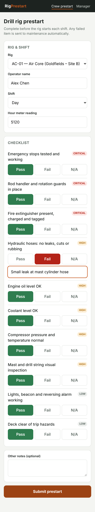
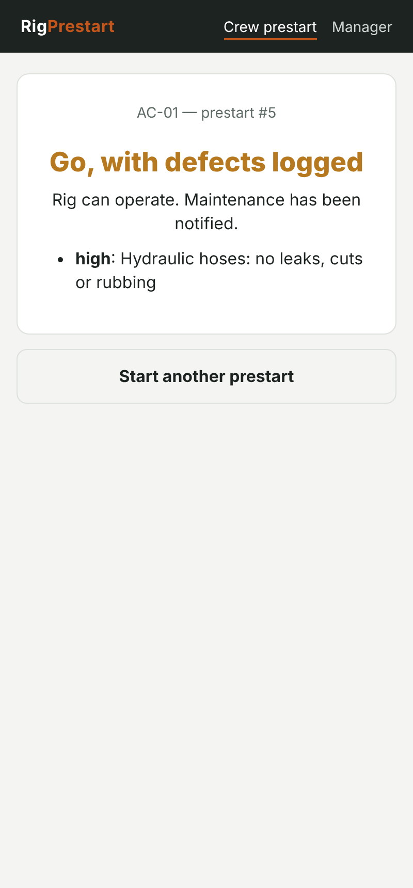
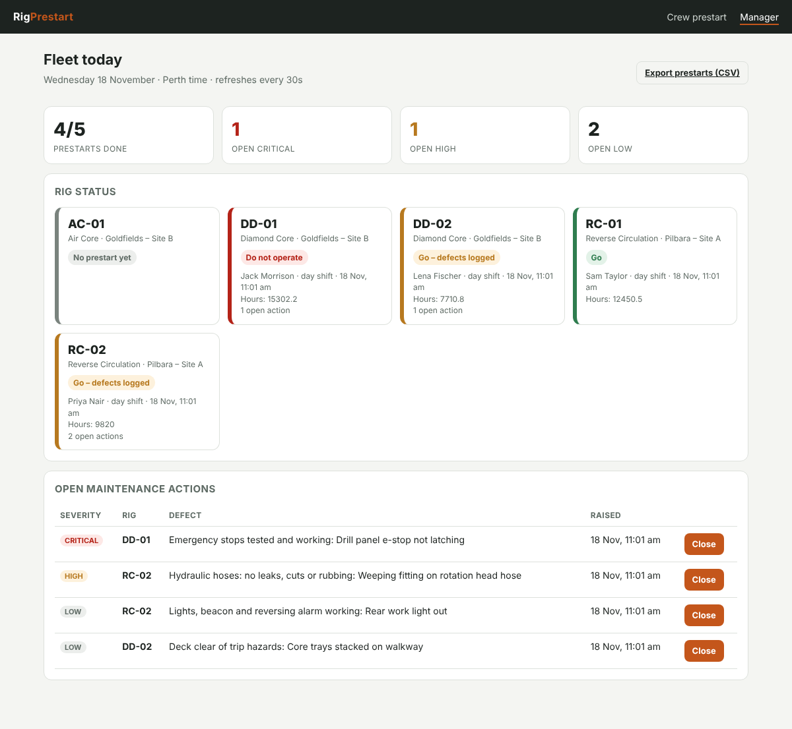

# Rig Prestart

A prestart checklist for drill rig crews, with a live dashboard for managers.

Crews complete the prestart on their phone before each shift. Any failed item automatically becomes a maintenance action. Managers can see at a glance which rigs are safe to run, which haven't done a prestart yet, and what's still open.

| Crew form (mobile) | Result | Manager dashboard |
|---|---|---|
|  |  |  |

## What it does

- **Crew prestart form**: pick the rig, enter the hour meter, then Pass / Fail / N/A for 10 checklist items. A failed item requires a description of the defect.
- **Automatic outcome**:
  - Any **critical** fail (e-stops, guards, fire extinguisher) → **Do not operate**
  - Any other fail → **Go, with defects logged**
  - All pass → **Go**
- **Maintenance actions**: every failed item creates an action, sorted by severity.
- **Manager dashboard**: rig status, prestart completion (e.g. 4/5 done), and open actions by severity. Actions can be closed with a name and note. The page refreshes every 30 seconds.
- **Safety rule**: an open critical action keeps the rig on "Do not operate", even if a later prestart passes, until someone closes it.
- **Data quality**: the hour meter can't go backwards for a rig, every item must be answered, and the server re-checks everything the browser checks.
- **CSV export** of all prestarts, for finance or audits.

## Tech

- **Backend:** Python, FastAPI, SQLite (no setup needed)
- **Frontend:** plain HTML, CSS and JavaScript (no build step), mobile-first
- **Tests:** pytest, 12 tests covering the outcome rules, validation and actions

```
app/
  main.py        API routes, outcome rules, dashboard logic
  db.py          SQLite schema and demo rigs
  checklist.py   The checklist items and their severity
  static/        Crew form, manager dashboard, styles
tests/           API tests
scripts/         Demo data loader
```

## Run it

```bash
python -m venv .venv
source .venv/bin/activate            # Windows: .venv\Scripts\activate
pip install -r requirements.txt -r requirements-dev.txt

python -m scripts.seed_demo          # optional: load a demo morning of prestarts
uvicorn app.main:app --reload
```

- Crew form: http://localhost:8000
- Manager dashboard: http://localhost:8000/manager
- API docs (auto-generated): http://localhost:8000/docs

Run the tests:

```bash
pytest
```

## API

| Method | Path | Purpose |
|---|---|---|
| GET | `/api/checklist` | Checklist items and severity |
| GET | `/api/rigs` | Rigs, with last hour meter reading |
| POST | `/api/prestarts` | Submit a prestart (returns the outcome and any actions created) |
| GET | `/api/prestarts?date=YYYY-MM-DD` | Prestarts for a day (defaults to today, Perth time) |
| GET | `/api/actions?status=open\|closed\|all` | Maintenance actions |
| POST | `/api/actions/{id}/close` | Close an action |
| GET | `/api/dashboard` | Everything the manager screen needs |
| GET | `/api/export/prestarts.csv` | All prestarts as CSV |

## What I'd build next

- Sign-in for crews and managers, with roles
- Offline mode for sites with no signal (save on the phone, sync later)
- Photos attached to defects
- Push or SMS alerts to the maintenance supervisor on a critical fail
- Pull rig hours and work orders from the maintenance system, instead of typing them in
- Postgres instead of SQLite for multi-user use

## How it was built

Built with an AI coding assistant to move quickly, then reviewed, run and tested. Writing the tests caught a real bug: two prestarts submitted in the same second showed the wrong "latest" status. It's fixed now, and a test covers it.
